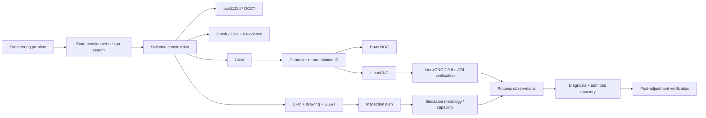

# Geometric Manufacturing Runtime

> **A constraint-driven manufacturing compiler that takes an engineering problem through generative design, CAD, structural verification, DFM/GD&T, CAM, controller-specific NC, inspection planning, and bounded process recovery.**

This is a public manufacturing/CNC research portfolio. It is intentionally **not** a universal CAD platform and it does **not** claim physical shop-floor validation where only simulated or recorded evidence exists.

## The story in one diagram



The central rule is simple:

> **Models may propose. Typed semantics, independent evidence, and explicit authority boundaries decide what is trusted.**

## Flagship result

The flagship is a CNC-machined sensor bracket generated from interfaces, loads, requirements, material, stock, machining capability, and design objectives.

| Result | Evidence |
| --- | --- |
| Search space | 900 exhaustive candidates |
| Bounded search | 183 states expanded / 400 unique states / 734 action edges |
| Search correctness | same winner as exhaustive enumeration |
| Selected design | `candidate-0046`, 8 mm plate, ~62.30 g |
| Analytical displacement | ~0.06398 mm |
| External FEA | ~0.06319 mm on the finest recorded Gmsh/CalculiX mesh |
| Controller verification | LinuxCNC 2.9.8 `rs274` accepts the exact emitted program/fixture |
| Inspection packet | drawing, GD&T, DFM, inspection plan, simulated first article, capability projection |
| Determinism | repeated portfolio runs reproduce the same content-addressed artifacts |

The target interpreter caught a real postprocessor bug during development: LinuxCNC rejected the Haas-style `G43 Hnn Z...` form. The controller layer now correctly emits:

```text
Haas:      G43 H02 Z8
LinuxCNC:  G43 H02
           G00 Z8
```

The Motion IR did not change; only target semantics did.

**Full flagship walkthrough:** [docs/FLAGSHIP.md](docs/FLAGSHIP.md)

## When the nominal process stops behaving nominally

The same manufacturing plan feeds five executable recovery case studies.

| Case | Observation source | Diagnosis | Bounded response |
| --- | --- | --- | --- |
| Bore drift | machine feedback | tool-wear drift | +0.006 mm finish-bore correction, then remeasure |
| Clamp distortion | metrology + human correction | clamp-induced distortion | reduce clamp-force scale 1.20 → 0.72 |
| Chatter | vibration + human correction | excessive actual stickout | shorten T4 from 42 → 28 mm |
| Failed GR&R | metrology | measurement system inadequate | quarantine gauge; **do not compensate machining** |
| Thermal bias | machine/metrology feedback | thermal drift | −0.043 mm X work-offset correction |

Human corrections are **observations**, not privileged commands. A machinist can correct stale setup facts such as actual stickout or clamp load, but the same typed compiler, evidence-quality checks, and admitted-action rules still apply.

A quarantined measurement system cannot drive dimensional compensation.

**Recovery overview:** [docs/RECOVERY.md](docs/RECOVERY.md)

**Five generated case studies:** [docs/case-studies/README.md](docs/case-studies/README.md)

## What is real, recorded, simulated, and intentionally unclaimed

| Layer | Evidence level |
| --- | --- |
| Design search / analytical screening | deterministic executable model |
| CAD realization | real build123d / OCCT execution |
| Structural result | recorded real Gmsh 4.15.2 + CalculiX 2.23 execution, digest-bound to the candidate |
| NC target semantics | recorded real LinuxCNC 2.9.8 `rs274` execution, digest-bound to exact NC/INI/tool table |
| Drawing / DFM / inspection plan | generated engineering definition for portfolio review |
| Metrology / Cp/Cpk | deterministic **synthetic** measurements and capability projections |
| Recovery cases | deterministic **simulated** process observations exercising the real recovery runtime |
| Physical machining | **not claimed** |
| Production capability / GR&R / machine approval | **not claimed** |

The distinction is intentional. The project is designed to make the boundary between model evidence and physical evidence explicit rather than blur it.

## Why this is different from text-to-CAD

Natural language is not design authority.

The trusted entry point is a typed `DesignProblem` containing interfaces, loads, keep-outs, requirements, material, manufacturing capability, design grammar, and objectives. The runtime then exposes only legal state-conditioned engineering actions and evaluates them against explicit obligations.

The first topology-changing action—a retained in-plane root buttress—was added only after CAD, structural verification, and 3-axis manufacturing could all represent the same construction without silently approximating it away.

## Quick start

```bash
npm install
npm run setup:portfolio
npm run verify
npm run portfolio:demo
```

Main generated evidence:

```text
artifacts/
├── sensor-bracket-v1/
│   ├── engineering-drawing.pdf
│   ├── dfm-report.pdf
│   ├── inspection-plan.pdf
│   ├── simulated-metrology.pdf
│   ├── setup-sheet.pdf
│   ├── sensor-bracket.haas.ngc
│   ├── sensor-bracket.linuxcnc.ngc
│   ├── linuxcnc-rs274.canonical.txt
│   └── ...
└── process-recovery/
    ├── bore-tool-wear-drift.case-study.pdf
    ├── clamp-induced-distortion.case-study.pdf
    ├── chatter-excessive-stickout.case-study.pdf
    ├── gage-rr-failure.case-study.pdf
    └── thermal-drift.case-study.pdf
```

Generated evidence under `artifacts/` is intentionally ignored by git. Frozen external-tool receipts needed for reproducible binding live under `examples/`.

## Repository tour

| If you care about… | Start here |
| --- | --- |
| the end-to-end manufacturing case | [docs/FLAGSHIP.md](docs/FLAGSHIP.md) |
| process troubleshooting / recovery | [docs/RECOVERY.md](docs/RECOVERY.md) |
| the five individual recovery studies | [docs/case-studies/README.md](docs/case-studies/README.md) |
| module boundaries and authority | [ARCHITECTURE.md](ARCHITECTURE.md) |
| current standards/toolchain research | [docs/RESEARCH-NOTES.md](docs/RESEARCH-NOTES.md) |
| public semantic contracts | [contracts/README.md](contracts/README.md) |
| example source/evidence inputs | [examples/](examples/) |
| implementation | [src/](src/) |

## Engineering boundaries

- TypeScript owns trusted design/manufacturing/recovery semantics.
- build123d/OCCT realizes geometry; it does not own design intent.
- the external structural project owns FEA evidence.
- CAM precedes controller-neutral Motion IR; controller profiles own target semantics.
- ReportLab renders evidence packets but owns no engineering meaning.
- machine, metrology, and human observations compile before recovery policy.
- recovery changes process-control state, not canonical product geometry.
- XState is reserved for lifecycle behavior; Effect owns mechanisms, not authority.
- generated NC, simulation, and synthetic metrology do not authorize a physical machine.

For the detailed rationale, see [ARCHITECTURE.md](ARCHITECTURE.md).